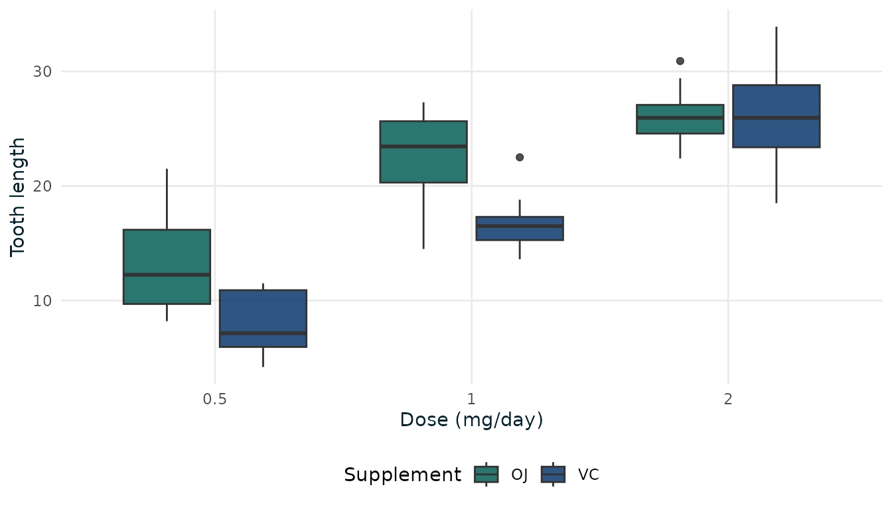

# Getting started with mypackage

``` r

library(mypackage)
library(ggplot2)
```

## Summarising data

[`summarise_by_group()`](https://neu-data.github.io/mypackage/reference/summarise_by_group.md)
gives a quick descriptive summary by group:

``` r

summarise_by_group(ToothGrowth, "len", "supp")
#>   supp  n  mean   sd median missing
#> 1   OJ 30 20.66 6.61   22.7       0
#> 2   VC 30 16.96 8.27   16.5       0
```

## Neudata-styled figures

Use
[`theme_neudata()`](https://neu-data.github.io/mypackage/reference/theme_neudata.md)
with
[`scale_colour_neudata()`](https://neu-data.github.io/mypackage/reference/theme_neudata.md)
or
[`scale_fill_neudata()`](https://neu-data.github.io/mypackage/reference/theme_neudata.md):

``` r

ggplot(ToothGrowth, aes(factor(dose), len, fill = supp)) +
  geom_boxplot(alpha = 0.85) +
  scale_fill_neudata(name = "Supplement") +
  labs(x = "Dose (mg/day)", y = "Tooth length") +
  theme_neudata()
```


